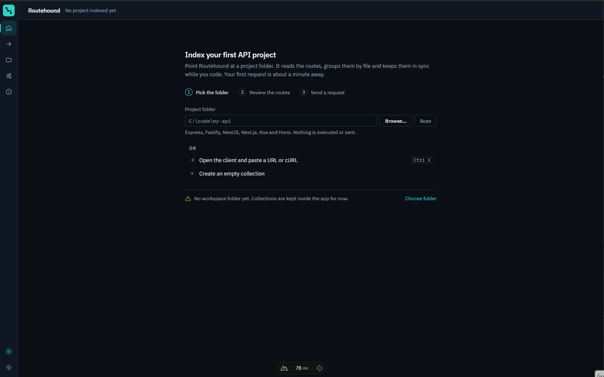

# Routehound

**Your API collection writes itself — from your code, and it never leaves your machine.**

Routehound is a desktop API client (like Bruno or Postman) that **indexes the endpoints of your
projects automatically**. Point it at an API project and it builds the collection, grouped by
file. When the code changes, it re-indexes and merges, keeping your names, saved requests and
docs, and flagging routes that are gone instead of deleting them.

Windows and Linux (macOS coming soon).

## Download

Get the installer for your system from [Releases](https://github.com/issacbrizuela1/PUB-P-APP-ROUTEHOUND/releases/latest):

| System | File |
|---|---|
| Windows 10/11 (x64) | `-setup.exe` |
| Linux (x64) | `.deb` (Debian, Ubuntu), `.rpm` (Fedora, openSUSE) or `.AppImage` (any distro) |
| macOS (Intel and Apple Silicon) | coming soon |

Builds are not code-signed yet, so Windows SmartScreen will ask for confirmation
("More info › Run anyway").

This repository only hosts the releases and the website ([web/](web)); the source code is private.

Website: https://issacbrizuela1.github.io/PUB-P-APP-ROUTEHOUND/

## Support

Routehound is free and made by one developer. If it saves you time, you can
[buy me a coffee on Ko-fi](https://ko-fi.com/issacb).

## License

[PolyForm Shield 1.0.0](LICENSE): free to use, modify and use at work. You may not offer it as a
product that competes with Routehound. Version 0.1.0 was released under FSL-1.1-MIT and keeps that license.
