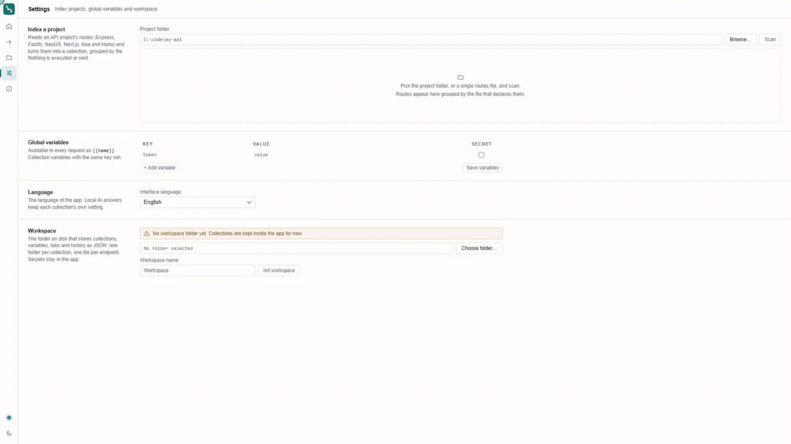

# Routehound

**Your API collection writes itself — from your code, and it never leaves your machine.**

Routehound is a desktop API client (like Bruno or Postman) that **indexes the endpoints of your
projects automatically**. Point it at an API project and it builds the collection, grouped by
file. When the code changes, it re-indexes and merges, keeping your names, saved requests and
docs, and flagging routes that are gone instead of deleting them.

Windows and Linux (macOS coming soon).

## Features

- **Indexing from code**: Express, Fastify, NestJS, Next.js, Koa and Hono: imports, mounted routers, prefixes and aliases.
- **Stays in sync**: a folder watcher re-indexes and merges, keeping your names, saved requests and docs. Gone routes are flagged, not deleted.
- **Local AI fallback**: when the indexer finds nothing (FastAPI, Laravel, Spring, Go…), your LM Studio model proposes the routes for review. It also finds GraphQL operations, one entry each.
- **Request editor**: params, headers, JSON, XML, form and multipart bodies with files, body variants, `{{variables}}` with environments per collection and a Production guard, port per endpoint, native send without CORS, code editor with JSON format, response filter by path, history, cURL import and `Ctrl K`.
- **Local-first**: one folder per collection, one JSON file per endpoint, ready for git. Secrets stay in the OS keychain.
- **Import and export**: OpenAPI/Swagger (JSON or YAML), Postman v2.x and Bruno in. OpenAPI 3 out.

## How it compares

| | Routehound | Bruno | Postman |
|---|---|---|---|
| Builds the collection from your code | ✅ (Node; others via local AI) | ❌ (from an OpenAPI spec) | 🟡 (from live traffic) |
| Keeps it in sync as code changes | ✅ (watcher + merge) | 🟡 (spec sync) | 🟡 (traffic agent) |
| Local-first, files in git | ✅ | ✅ | 🟡 |
| AI without sending code to the cloud | ✅ (LM Studio) | 🟡 | ❌ |
| GraphQL | 🟡 (found by local AI) | ✅ | ✅ |
| Scripting, test runner, gRPC | ❌ (not yet) | ✅ | ✅ |

## Download

Get the installer for your system from [Releases](https://github.com/issacbrizuela1/PUB-P-APP-ROUTEHOUND/releases/latest):

| System | File |
|---|---|
| Windows 10/11 (x64) | `-setup.exe` |
| Linux (x64) | `.deb` (Debian, Ubuntu), `.rpm` (Fedora, openSUSE) or `.AppImage` (any distro) |
| macOS (Intel and Apple Silicon) | coming soon |

Builds are not code-signed yet, so Windows SmartScreen will ask for confirmation
("More info › Run anyway").

This repository only hosts the releases and the website ([web/](web)); the source code is private.

Website: https://issacbrizuela1.github.io/PUB-P-APP-ROUTEHOUND/

## Help

Questions and bug reports go through [issues](https://github.com/issacbrizuela1/PUB-P-APP-ROUTEHOUND/issues/new/choose),
using one of the two templates. Read [SUPPORT.md](SUPPORT.md) first: issues are **public**, so never
paste tokens, passwords or private code. Security problems go through [SECURITY.md](SECURITY.md), not an issue.

## Privacy and terms

No accounts, no telemetry, no analytics: everything stays on your machine. See the
[privacy notice](PRIVACY.md) and the [terms and conditions](TERMS.md) (also in About, inside the app).

## Support the project

Routehound is free and made by one developer. If it saves you time, you can
[buy me a coffee on Ko-fi](https://ko-fi.com/issacb).

## License

[PolyForm Shield 1.0.0](LICENSE): free to use, modify and use at work. You may not offer it as a
product that competes with Routehound. Version 0.1.0 was released under FSL-1.1-MIT and keeps that license.
